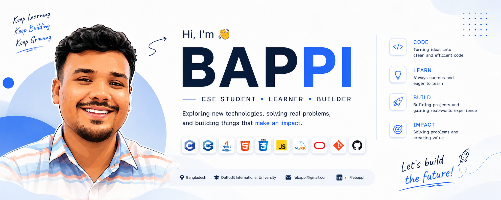

<!-- ===================== BANNER ===================== -->

  

<!-- ===================== INTRO ===================== -->

<h1 align="center">Fozle Elahe Bappi</h1>

<h3 align="center">
  Computer Science & Engineering Student · Developer in Progress
</h3>

  
  
  

---

## 👨‍💻 About Me

Hi, I'm **Fozle Elahe Bappi** (Bappi), a Computer Science and Engineering student at **Daffodil International University**.

I'm learning software development by building things and experimenting with different technologies. I enjoy solving problems, understanding how things work, and improving through hands-on practice.

I'm still learning, still building, and figuring things out one project at a time. 🚀

## 🌐 **Portfolio:** [febappi.netlify.app](https://febappi.netlify.app)

## 🔭 Currently

- 🌱 Exploring modern web development
- 💻 Working on personal projects
- 📚 Strengthening my programming fundamentals
- 🧩 Learning through hands-on development
- 🚀 Exploring new technologies and development tools

---

## 🛠️ Skills & Technologies

  

  
  

---

## 💡 What I Like

**Learn → Experiment → Build → Understand → Improve**

I enjoy turning ideas into something functional and learning from the problems that come along the way.

---

## 📊 GitHub Statistics

  

  
  

---

## 🔥 Contribution Streak

  

---

## 🐍 Contribution Graph

  <picture>
    <source media="(prefers-color-scheme: dark)" srcset="https://raw.githubusercontent.com/febappi/febappi/output/github-contribution-grid-snake-dark.svg" />
    
  </picture>

---

## 🌐 Connect With Me

  
  
  

---

  

<h3 align="center">
  Still learning. Still building. Still becoming. 🚀
</h3>
